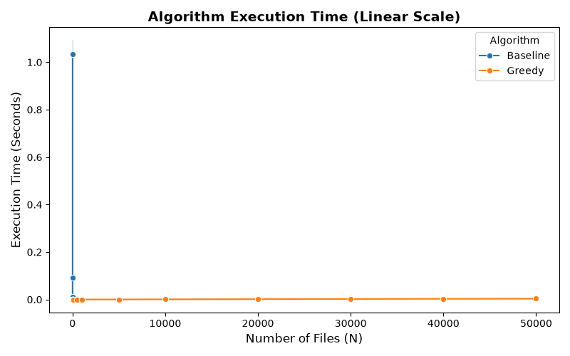
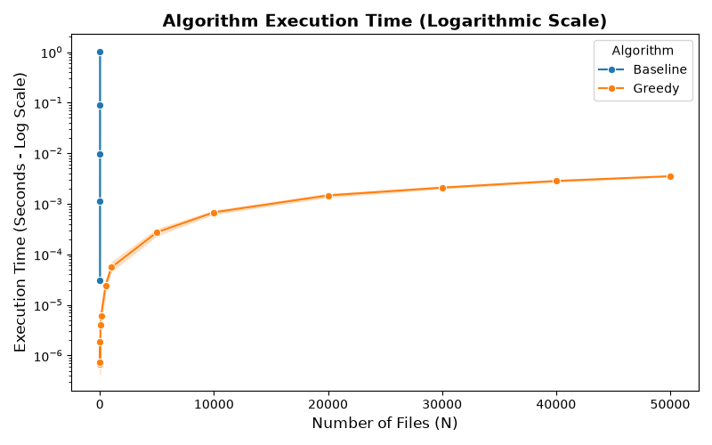
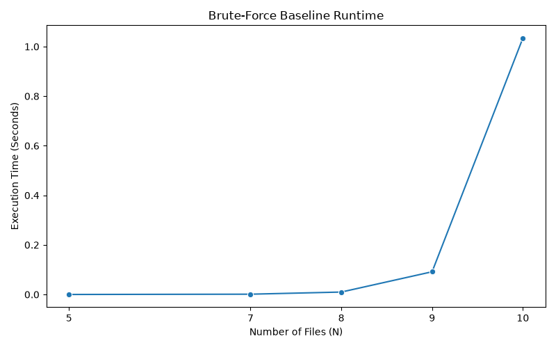

# Processing Files Problem

The Processing Files problem asks us to reorder a list of files so that the average completion time is minimized. Only one file can be processed at a time, so the order of the files affects how long each file waits before finishing. Our project compares a brute-force baseline with a more efficient greedy algorithm.

## Problem Formulation

We have a list of `n` files, written as `F = [f₁, f₂, ..., fₙ]`. Each file's size represents how long it takes to process. A file's completion time includes its own processing time and the time spent processing the files before it. Our goal is to arrange the files so that their average completion time is as small as possible.

For example, for the order `[8, 3, 6, 2]`, the completion times are $8$, $11$, $17$, and $19$, giving an average of $13.75$. Reordering the files to `[2, 3, 6, 8]` gives completion times $2$, $5$, $11$, and $19$, with an average of $9.25$.

## Baseline Solution

The baseline uses a brute-force approach. It generates every possible permutation of the files, calculates the average completion time for each permutation, and keeps the ordering with the smallest average.

For example, with the input `[8, 3, 6, 2]`, there are $4! = 24$ possible orderings. The baseline checks all 24 possibilities and finds that `[2, 3, 6, 8]` has the lowest average completion time, which is `9.25`.

```text
Algorithm ProcessFilesBaseline(F):
    best_order = F
    best_average = infinity

    for each permutation P of F:
        current_time = 0
        total_completion_time = 0

        for each file in P:
            current_time = current_time + file
            total_completion_time = total_completion_time + current_time

        average = total_completion_time / number of files

        if average < best_average:
            best_order = P
            best_average = average

    return best_order, best_average
```

The baseline guarantees an optimal result because it checks every possible ordering. However, it becomes impractical for large inputs. There are $n!$ possible permutations, and evaluating each permutation takes $O(n)$ time, so the overall time complexity is $O(n! \times n)$.

## Proposed Algorithmic Strategy

## Empirical Synthesis

Our empirical results show a significant difference in efficiency compared to the brute-force baseline and our proposed greedy algorithm. The baseline has a theoretical time complexity of **O(n × n!)** as it attempts all possible arrangements of the files. However, the greedy algorithm takes **O(n log n)** time since it sorts the files before determining the average completion time. Our benchmarking results are consistent with these theoretical expectations and show that the greedy approach is significantly more efficient as the number of files gets larger.

For an input size of 10 files, the brute-force algorithm took on average approximately **1.84 seconds**, while the greedy algorithm ran for approximately **0.00000314 seconds**. This difference demonstrates how fast the factorial complexity of the baseline becomes impractical. Hence the baseline benchmarks were restricted to smaller input sizes while the greedy algorithm was tested with up to 50,000 files. Even at this largest input size the greedy algorithm took **0.00528 seconds**, roughly.

We can also see from our visualizations how the algorithms differ. The baseline's runtime increases rapidly on the linear-scale graph, while the greedy algorithm appears almost flat as its running times are significantly smaller. The logarithmic-scale graph shows the runtime differences for the input sizes tested more effectively. In general, the running times of the greedy algorithm increased with input size. It did have some minor swings though, which could be due to system activity.

Overall, our empirical results support our theoretical analysis and show that the greedy algorithm is a much more scalable approach to the Processing Files problem. The greedy algorithm requires far less computation, but still gives the same optimal result as the baseline, which checks all possible orderings. One limitation of our evaluation is that the baseline was only measured at small input sizes so our benchmarks may offer limited direct evidence of its factorial growth.







## Baseline Comparison

## Reflection
